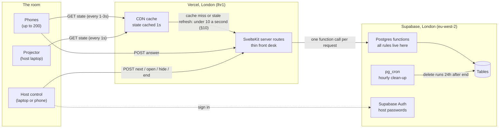
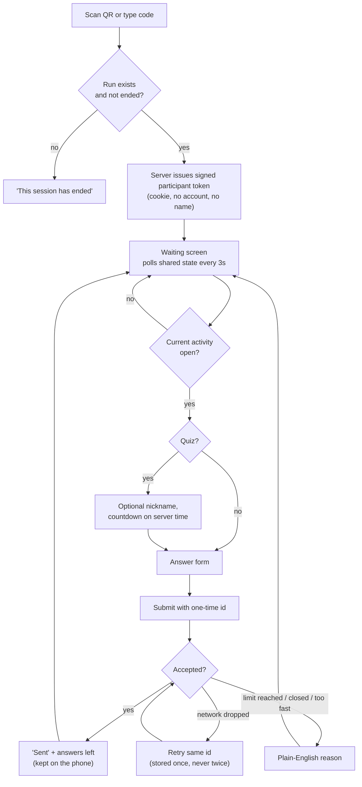
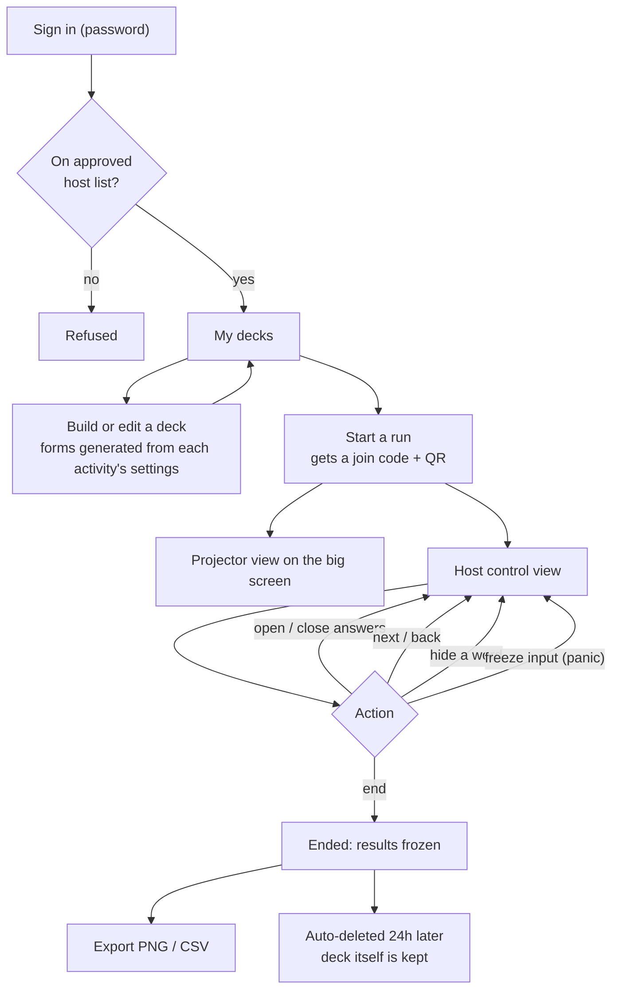
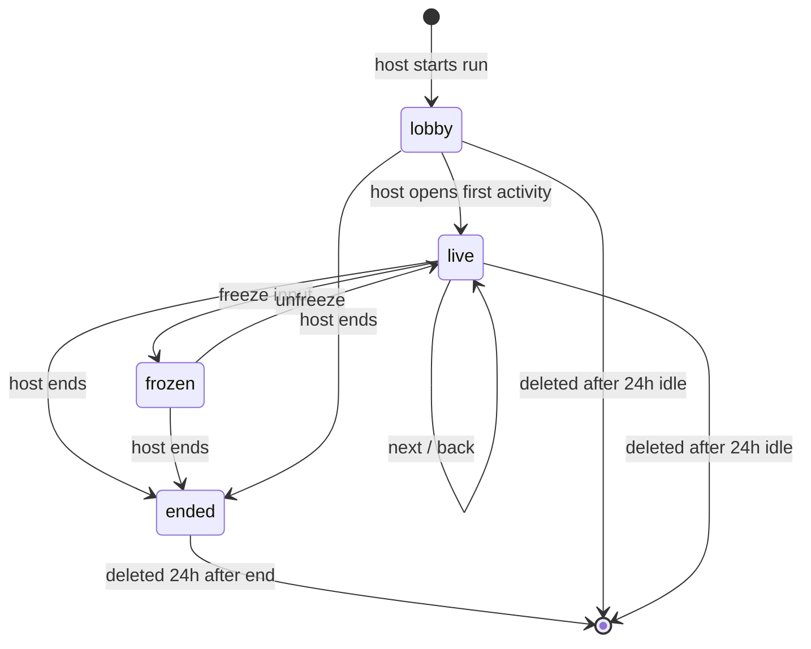
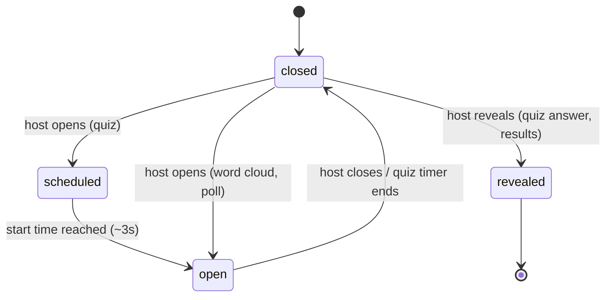
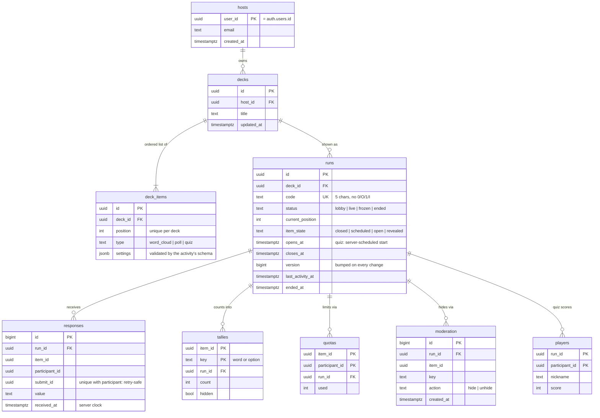
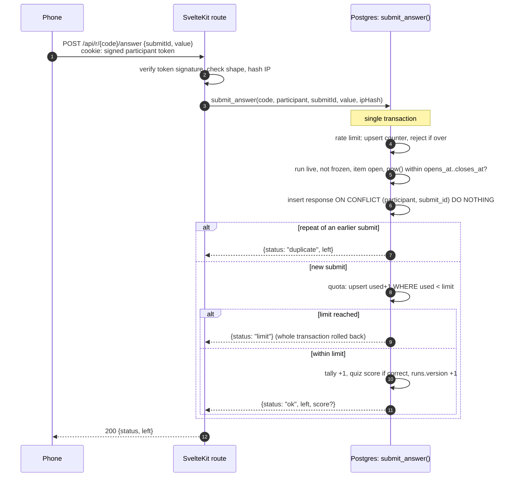
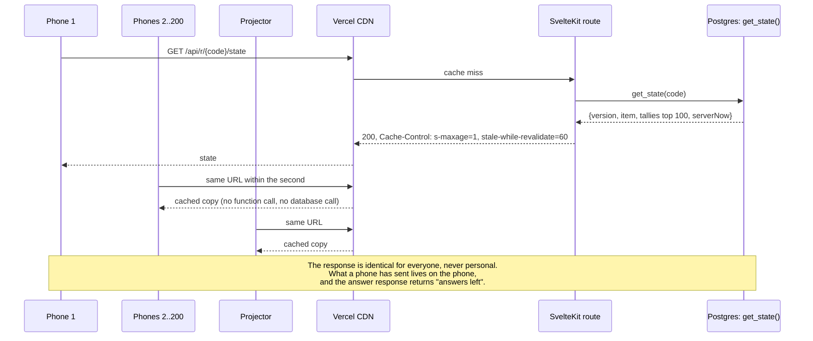
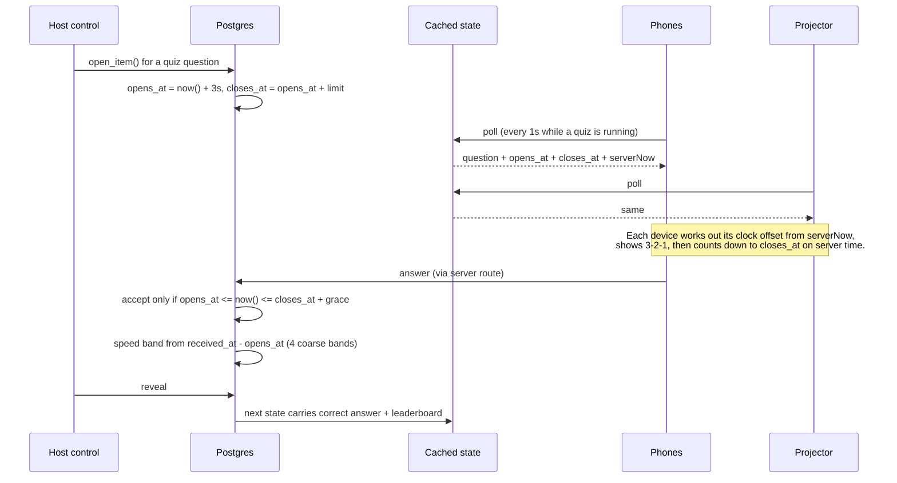
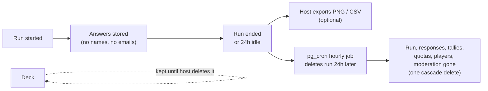

# Volley architecture

How Volley is put together, drawn out. Decisions behind it are in
`docs/DECISIONS.md`; what the first release does is in `SPEC.md`.

## 1. The system

Everything runs in London. Phones and the projector never talk to the database
directly and never hold a live connection: they read one shared, cached state
response and send answers through the server.

## 2. The participant's journey

## 3. The host's journey

## 4. Run and activity states

A run is one live showing of a deck. Only the server moves it between states.

## 5. The database

Decks are the host's content and are kept. Everything under `runs` is
participant data and is deleted 24 hours after the run ends.

Not shown: `rate_limits` (an **unlogged** table of per-IP-hash counters. It
skips the write-ahead log because losing it in a crash costs nothing).

**Why `tallies` exists.** Counting raw `responses` on every read would scan every
answer every second. Instead each accepted answer adds one to its tally row in the
same transaction, so reading the cloud is a small indexed read of already-counted
rows, whatever the number of answers.

## 6. Sending an answer

One request, one database call, one transaction. Every rule is checked inside it,
so two phones submitting at the same instant cannot sneak past a limit.

## 7. Reading state: why 200 phones cost a few calls a second

The state never includes a quiz's correct answer before the host reveals it.

## 8. A fair timed quiz without live connections

Because every device waited out the same scheduled start, a phone that polled
0.9s later still saw the question before it opened. Speed is measured on the
server's clock, never the phone's.

## 9. Where data goes, and when it leaves

## 10. Query catalogue and free-tier budget

Every request makes **at most one database call**, and every call is served by
an index.

| Request | Database call | Rows touched | Index |
|---|---|---|---|
| Phone or projector reads state | `get_state(code)` on cache miss only | 1 run, 1 item, ≤100 tallies, ≤10 players | `runs(code)` unique, `tallies(item_id, count desc)`, `players(run_id, score desc)` |
| Phone sends an answer | `submit_answer(...)` | 1 rate row, 1 response, 1 quota, 1 tally, 1 run | primary keys, `responses(participant_id, submit_id)` unique |
| Phone joins | none (token signed by the server) | 0 | – |
| Host action (open, next, hide, end) | one function per action | 1 run, plus the item's tallies for hide | primary keys |
| Host opens decks | `list_decks(host)` | the host's decks | `decks(host_id, updated_at desc)` |
| Hourly clean-up | `delete from runs where ...` | expired runs, cascading | `runs(ended_at)`, `runs(last_activity_at)` |

**One 200-person, 60-minute event, phones polling every 3s.** Measured rows
come from S1 (`docs/volley-plan.md`); the budget they're held to is ADR-004.

| Budget (free) | Usage | Measured or estimated | Why |
|---|---|---|---|
| Vercel function calls, 1M/month | ~25,000 | **measured**: 6.9 state calls/s (S1 run B) × 3,600s | the CDN doesn't merge stale refreshes for function responses (ADR-004) |
| | + ~600 | estimated | answers and host actions |
| Vercel Active CPU, 4h/month | a few minutes | estimated | thin handlers, mostly waiting on the database |
| Vercel data transfer, 100 GB/month | ~0.5 GB | estimated | 200 phones × 1,200 polls × ~2 KB |
| Supabase database, 500 MB | < 5 MB per event | estimated | deleted after 24h |
| Supabase egress, 5 GB/month | ~50 MB | estimated from the measured call count | ~25,000 state reads × ~2 KB |
| Supabase realtime | 0 | by design | not used |

At 1s polling the measured rate is 8.8 calls/s (S1 run A), about 32,000 an
hour. The S1 runs lasted 2 minutes. The 10-minute load check in `SPEC.md` (A10)
replaces the remaining estimates.
